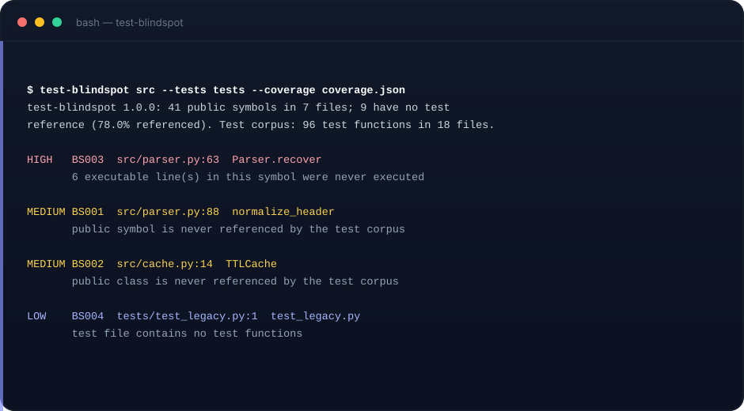

# test-blindspot

**See which public symbols your tests never mention.**


A zero-dependency Python CLI that extracts the public API of your source tree
and checks it against the identifiers used by your test corpus. Optionally
cross-checks real `coverage.py` JSON to separate "never mentioned" from
"mentioned but never executed".

[](https://github.com/muguang1224/test-blindspot/actions/workflows/ci.yml)
[](LICENSE)
[](https://www.python.org/)

> Agent Skill: [`SKILL.md`](SKILL.md) · CLI: `scripts/test_blindspot.py` · Tests: 47



## Why

Coverage reports start at the file level and hide the shape of the gap. A
module can be 80% covered while a whole public function is untouched.
`test-blindspot` answers three questions in one pass:

1. Which public functions, methods and classes are never referenced by tests?
2. Which of those have zero executed lines in a real coverage report?
3. Which "test" files contain no test functions at all?

It matches identifiers, not call graphs, so it under-reports rather than
inventing gaps.

## Quick start

```bash
python3 scripts/test_blindspot.py src --tests tests
python3 scripts/test_blindspot.py src --tests tests --coverage coverage.json
python3 scripts/test_blindspot.py src --tests tests --json gap.json --md gap.md
python3 scripts/test_blindspot.py --list-rules

# produce the coverage input
coverage run -m pytest && coverage json -o coverage.json
```

Exit codes: `0` clean (or below `--fail-on`), `1` findings at or above the
threshold, `2` usage / missing path / malformed coverage report.

## Rules

| Rule | Severity | Detects |
| --- | --- | --- |
| BS001 | medium | public function or method never referenced by tests |
| BS002 | medium | public class never referenced by tests |
| BS003 | high | symbol body has 0 executed lines in coverage data |
| BS004 | low | file named like a test but containing no test functions |

## Reading the report

```
test-blindspot 1.0.0: 12 public symbols in 3 files; 4 have no test reference (66.7% referenced).
Test corpus: 31 test functions in 6 files.

HIGH   BS003  src/parser.py:41  Parser.recover
       7 executable line(s) in this symbol were never executed
MEDIUM BS001  src/parser.py:58  normalize
       public symbol is never referenced by the test corpus
```

`--coverage` follows the pytest-cov / `coverage json` format. The `def` line
counts as executed at import time, so BS003 looks at the body, not the
signature. A bare basename that matches two source files is treated as
ambiguous and ignored.

## Suppression

```python
def legacy():  # blindspot: ignore=BS001
    ...

# blindspot: ignore-file
```

The file marker must be in a comment. `# blindspot: ignore` suppresses every
rule attached to that symbol, including on its decorator lines.

## What it does not do

- It does not claim "untested" — only "not referenced by name".
- It does not build a call graph: HTTP handlers exercised through a client,
  click commands run through subprocess, and decorator-registered functions
  will still be reported if tests never name them.
- It does not execute tests or query a registry.
- Name matching is global, so a method called `run` can be masked by an
  unrelated `run` in the test corpus.
- Python only (`.py`).

## CI

```yaml
- name: Test blindspots
  run: |
    coverage run -m pytest
    coverage json -o coverage.json
    python3 scripts/test_blindspot.py src --tests tests \
      --coverage coverage.json --fail-on high
```

## Tests

```bash
python3 -m unittest discover -s tests -v
```

47 tests cover symbol extraction, aliases, string-based references, coverage
mapping and ambiguity, suppression, and report/exit behaviour.

## Layout

```
SKILL.md                    Agent Skill instructions
scripts/test_blindspot.py   the whole tool
tests/                      unittest suite
assets/                     banner + terminal demo
.github/workflows/          CI
```

## 中文简介

`test-blindspot` 是一个零依赖的 Python 测试盲区扫描器。它提取源码里的公共函数、
方法和类，再在测试目录中按标识符查找引用，报告"测试从未提过"的公共 API；
还可以读取 `coverage json`，把"完全没执行"的符号单独标出。它只做按名字匹配，
宁可漏报也不臆造缺口；不做调用图、不执行测试、不查注册表。仅支持 Python。

MIT © 2026 muguang1224
